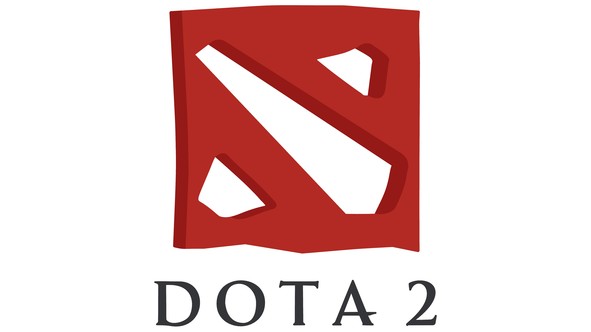
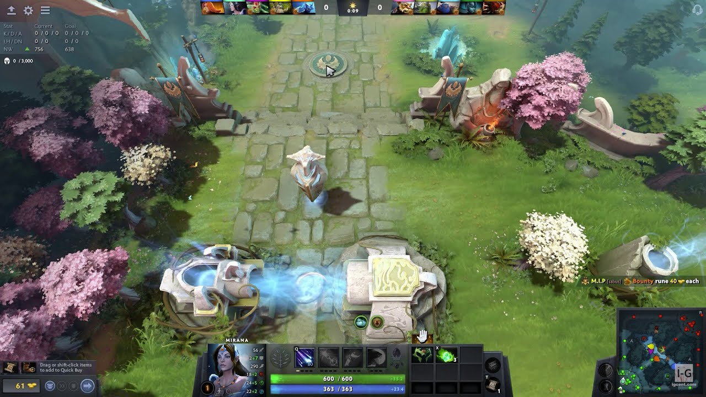

# Moje oblíbená hra: Dota 2

## O čem hra je?
*Dota 2 je free-to-play multiplayerová online bojová aréna (MOBA), kterou vyvinula a vydala společnost Valve. Hrají ji dva týmy po pěti hráčích, přičemž každý tým se snaží ubránit svou základnu a zničit základnu soupeře (tzv. *Ancient*).*

---

## 🔗 Užitečné odkazy
* Oficiální stránky hry najdeš na [Dota 2 Official Website](https://www.dota2.com).
* Podrobné statistiky, turnaje a informace o hře sleduj na [Liquipedia Dota 2](https://liquipedia.net/dota2/Main_Page).

---

## 🛡️ Ukázka ze hry

Níže můžeš vidět ukázku toho, jak vypadá akce během zápasu:

Další užitečné informace najdeš ve složce [docs](docs/), kde rozepisuji základní tipy pro začátečníky.
